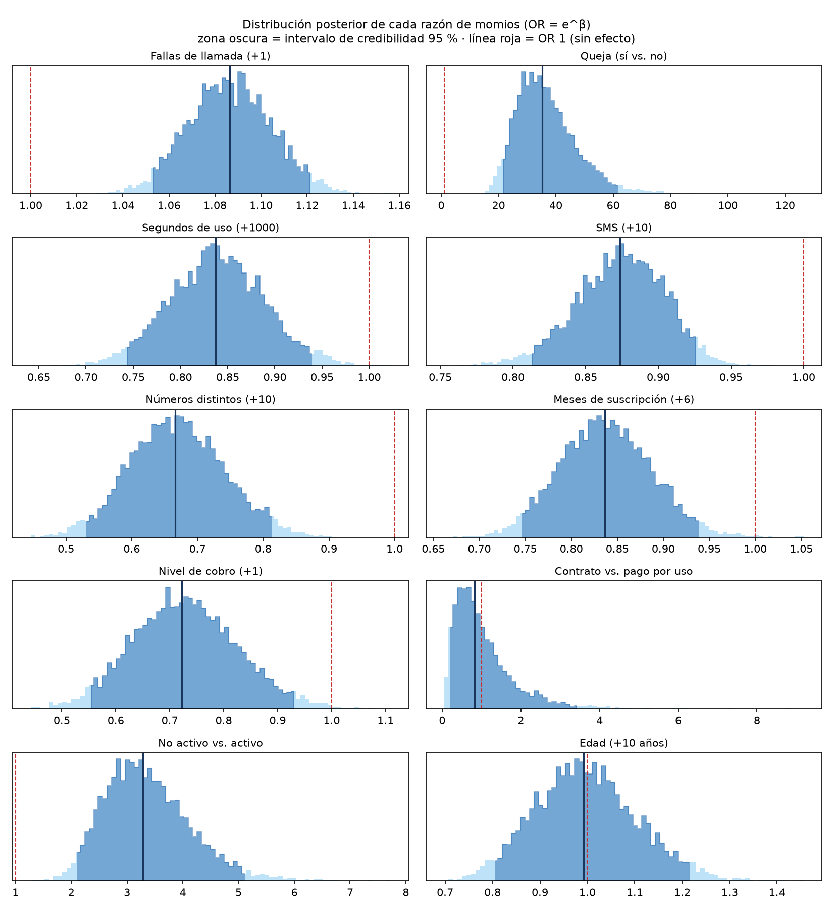
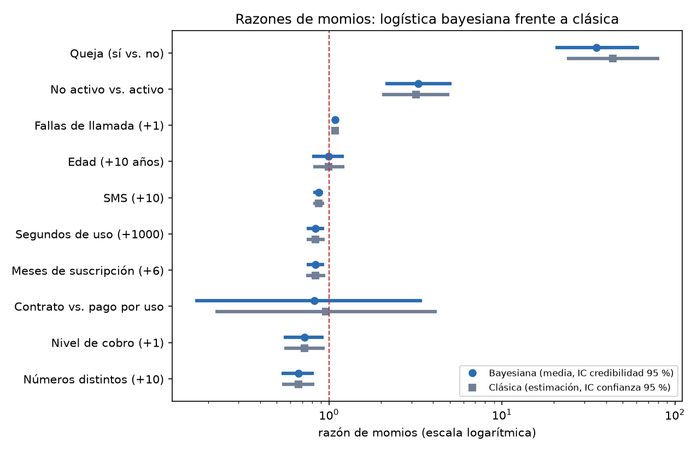
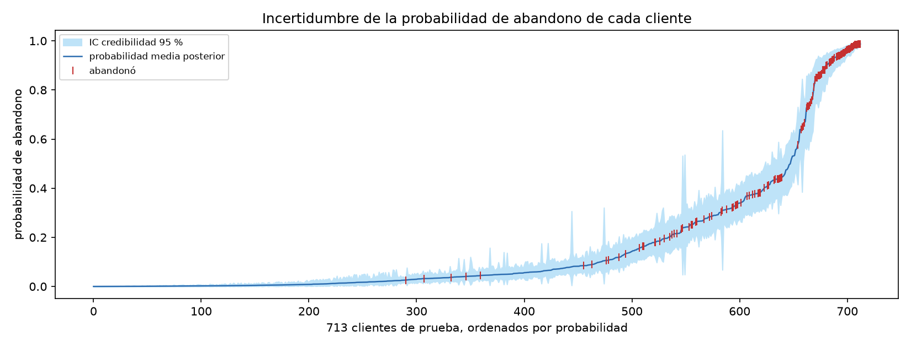
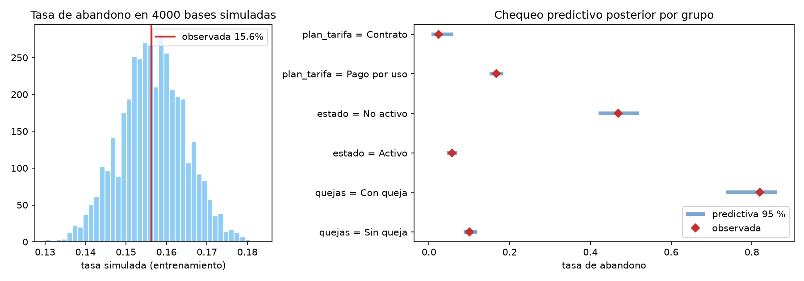
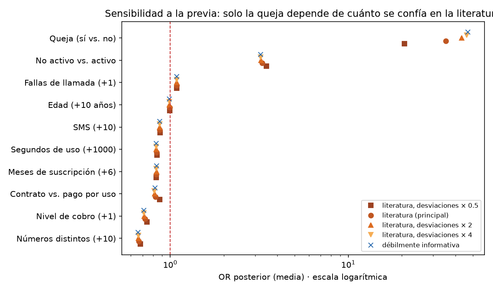
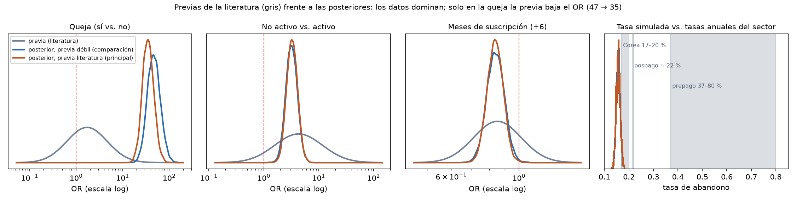

# Regresión logística bayesiana frente a la logística clásica: resultados

Ianis Ramírez Cárdenas · Juan Esteban Acosta Morales · Estadística Bayesiana · 6 de noviembre de 2026

> Todas las cifras salen de `reports/tablas/bayes_*.csv`, `reports/tablas/logistica_mv.csv` y
> `reports/tablas/bayes_probabilidades.json`, generadas con `python scripts/bayes.py` (semilla 42).
> Las figuras están en `reports/figures/bayes_*.png`. Las fuentes de las previas y la justificación
> del muestreo están en `docs/fuentes_previas.md`. Las decisiones, en `docs/decisiones.md`
> (4 de noviembre). El mismo modelo en R con rstanarm: `scripts/bayes_rstanarm.R`.

## 1. Pregunta y datos

¿En qué medida las características de uso, servicio y suscripción de los primeros nueve meses
permiten anticipar qué clientes abandonan al cierre del mes doce? Se usa el Iranian Churn Dataset
(Keramati et al., 2014; UCI, 2020) depurado: **2850 clientes únicos, 446 abandonos (15.6 %)**. La
base se parte por cliente, estratificada, en **2137 de entrenamiento** y **713 de prueba (112
abandonos)**. Los modelos se ajustan solo con entrenamiento; la prueba se usa una vez, al final.

Variables (10): fallas de llamada, queja (0/1), segundos de uso, frecuencia de SMS, números
distintos marcados, meses de suscripción, nivel de cobro (0–10), plan (1 = pago por uso,
2 = contrato), estado (1 = activo, 2 = no activo) y edad. Se retiraron `grupo_edad` (igual a la
edad), `valor_cliente` (VIF 53) y `frecuencia_llamadas` (r = 0.95 con segundos de uso).

## 2. Modelo y previas

Para el cliente *i*, con *Yᵢ* = 1 si abandona:

  logit(πᵢ) = ln(πᵢ / (1 − πᵢ)) = β₀ + β₁xᵢ₁ + … + β₁₀xᵢ₁₀,  Yᵢ ~ Bernoulli(πᵢ)

Por el teorema de Bayes, P(β | Y, X) ∝ P(Y | X, β) · P(β), con verosimilitud
∏ πᵢ^Yᵢ (1 − πᵢ)^(1−Yᵢ).

### Previas principales: sustentadas en la literatura

No encontramos una tasa de churn publicada del operador ni del mercado iraní. Lo que sí hay son
efectos publicados en otros mercados, y con ellos se construyen las previas. Se usa la evidencia
externa donde existe y se **descuenta**: la desviación de cada previa se ensancha frente al error
estándar publicado, porque viene de otro país, otra época y a veces otra definición de la variable
(*power priors*, Ibrahim y Chen, 2000). Ninguna previa sale de esta base ni de Keramati et al.
(2014), que publicó los mismos datos.

| Parámetro | Evidencia publicada | Previa (escala original) | Qué admite al 95 % |
|---|---|---|---|
| Estado no activo | Cliente "sin uso": β = 1.455 (EE 0.349), OR ≈ 4.3; operador coreano (Ahn, Han y Lee, 2006) | β ~ N(1.46, 1.0) | OR entre 0.61 y 30.6 |
| Queja | Cada queja: β = 0.538 (EE 0.323), OR ≈ 1.7 (Ahn, Han y Lee, 2006). Aquí es "alguna queja" (0/1), por eso la desviación triplica el EE | β ~ N(0.54, 1.0) | OR entre 0.24 y 12.2 |
| Meses de suscripción | Cada mes: OR 0.974 (EE ≈ 0.003); operador del Reino Unido (arXiv:1607.07792) | β ~ N(−0.027, 0.03) por mes | OR por 6 meses entre 0.60 y 1.21 |
| Intercepto y otras 7 variables | Sin evidencia transferible (otras unidades o variables) | N(0, 2.5) por desviación estándar (Gelman et al., 2008) | Débilmente informativa |

Las tres previas informadas admiten el "sin efecto" (OR = 1) dentro de su 95 %. Orientan la
dirección y el tamaño esperado, pero dejan que los datos contradigan a la literatura.

**Por qué el intercepto no toma la tasa del sector.** Las tasas publicadas (17–20 % anual en Corea,
≈ 22 % en pospago, 37–80 % en prepago emergente) son el **promedio** de abandono. El intercepto es el
riesgo del cliente con **todas las variables en su promedio**: en esta base, ≈ 3 %. Son cantidades
distintas. Las tasas del sector se usan como contraste en el chequeo predictivo (sección 7b).

### Previa de comparación: débilmente informativa

β_j ~ Normal(0, 2.5) por desviación estándar en las 10 variables, que son las previas por defecto
de `rstanarm` (Gelman et al., 2008). Sirve para ver cuánto pesa la literatura en las conclusiones
(sección 7b).

**La logística clásica** es el mismo modelo estimado por máxima verosimilitud, sin previa (como
`glm(family = binomial)`), con intervalos de confianza de Wald.

## 3. Estimación por MCMC y diagnósticos

**Por qué MCMC.** La logística no tiene previa conjugada, así que la posterior solo se conoce salvo
una constante, una integral en 11 dimensiones. Las alternativas fallan aquí:

- Una cuadrícula necesitaría 100¹¹ puntos.
- La aproximación de Laplace supone simetría y recorta la cola derecha del OR de la queja: 33.2
  (19.2–57.4) frente a 35.3 (20.4–62.3) con MCMC. La asimetría posterior es de 1.06, y en el plan
  de contrato de 2.53.
- La inferencia variacional tiende a subestimar la incertidumbre.

MCMC converge a la posterior exacta y permite calcular cualquier cantidad a partir de las muestras
(`bayes_laplace_vs_mcmc.csv`).

**Por qué HMC dentro de MCMC.** Se muestreó con Monte Carlo hamiltoniano (HMC): **4 cadenas, 1000
iteraciones de calentamiento y 2000 muestras por cadena (8000 en total)**. Con las mismas muestras,
un Metropolis de paseo aleatorio logra n_eff/N = 0.020 y R̂ = 1.028, que no cumple el criterio;
HMC logra 0.56 y 1.003, unas 28 veces más muestras efectivas por iteración
(`bayes_eficiencia_mcmc.csv`). Gibbs no aplica sin aumentar los datos, porque las condicionales de
la logística no son estándar. El muestreador está programado en `src/churn/bayes.py` con numpy.

| Diagnóstico | Valor | Criterio | |
|---|---|---|---|
| R̂ máximo | 1.003 | < 1.01 | cumple |
| n_eff mínimo | 4509 | — | |
| n_eff/N | entre 0.56 y 0.70 | alto, cercano a 1 | cumple |
| Divergencias | 0 | 0 | cumple |
| Aceptación media | 0.83 | ≈ 0.8 | cumple |

Las cuatro cadenas recorren la misma región y sus densidades se superponen (`bayes_trazas.png`).

## 4. Coeficientes posteriores

Resumen en la escala original, como `summary()` de rstanarm:

| Parámetro | Media (β) | DE | 2.5 % | 97.5 % | n_eff/N | R̂ |
|---|---|---|---|---|---|---|
| Intercepto | −1.457 | 0.947 | −3.289 | 0.438 | 0.59 | 1.001 |
| Fallas de llamada | 0.0829 | 0.0166 | 0.0510 | 0.1155 | 0.56 | 1.001 |
| Queja | 3.565 | 0.283 | 3.014 | 4.133 | 0.70 | 1.003 |
| Segundos de uso | −0.000178 | 0.000059 | −0.000299 | −0.000065 | 0.61 | 1.001 |
| Frecuencia de SMS | −0.0135 | 0.0034 | −0.0206 | −0.0075 | 0.58 | 1.003 |
| Números distintos | −0.0406 | 0.0107 | −0.0633 | −0.0204 | 0.60 | 1.001 |
| Meses de suscripción | −0.0297 | 0.0101 | −0.0496 | −0.0102 | 0.67 | 1.001 |
| Nivel de cobro | −0.325 | 0.135 | −0.602 | −0.069 | 0.58 | 1.002 |
| Plan (contrato) | −0.202 | 0.747 | −1.780 | 1.174 | 0.59 | 1.001 |
| Estado (no activo) | 1.187 | 0.227 | 0.746 | 1.628 | 0.57 | 1.001 |
| Edad | −0.0009 | 0.0108 | −0.0227 | 0.0196 | 0.67 | 1.002 |

## 5. Razones de momios e interpretación

OR = e^β, con el intervalo de credibilidad del 95 % (e^(2.5 %), e^(97.5 %)). Para las variables de
conteo se lee por una unidad con sentido (+10 SMS, +1000 segundos…), porque por un SMS o un segundo
el OR es casi 1. Todas las lecturas son **manteniendo constantes las demás variables**.

| Variable | Unidad | OR (media) | IC credibilidad 95 % | P(β > 0) |
|---|---|---|---|---|
| Queja | sí frente a no | **35.33** | (20.36, 62.34) | 1.000 |
| Estado | no activo frente a activo | **3.28** | (2.11, 5.09) | 1.000 |
| Fallas de llamada | +1 falla | 1.086 | (1.052, 1.122) | 1.000 |
| Segundos de uso | +1000 s (≈ 17 min) | 0.837 | (0.742, 0.937) | 0.000 |
| Frecuencia de SMS | +10 SMS | 0.874 | (0.814, 0.928) | 0.000 |
| Números distintos | +10 números | 0.666 | (0.531, 0.815) | 0.000 |
| Meses de suscripción | +6 meses | 0.837 | (0.743, 0.941) | 0.001 |
| Nivel de cobro | +1 nivel | 0.723 | (0.548, 0.934) | 0.007 |
| Plan | contrato frente a pago por uso | 0.82 | (0.17, 3.24) | 0.413 |
| Edad | +10 años | 0.991 | (0.797, 1.217) | 0.471 |

- **Queja.** Las *odds* de abandonar de quien se quejó son unas **35 veces** las de quien no se
  quejó. Con 95 % de probabilidad, según el modelo, los datos y la literatura, el factor está entre
  20 y 62. P(OR > 10) = 1.00. Es, por mucho, la señal más fuerte, aunque la literatura esperaba un
  efecto mucho menor (sección 7b).
- **Estado no activo.** Multiplica las *odds* por **3.3** (entre 2.1 y 5.1), en línea con el OR ≈ 4.3
  publicado.
- **Fallas de llamada.** Cada falla adicional multiplica las *odds* por 1.086 (**+8.6 %**; entre
  +5 % y +12 %). Por sí sola esta variable casi no se relaciona con el abandono (r = −0.01), porque
  quien más llama también tiene más fallas. Solo cuando se comparan clientes con el mismo uso
  aparece su efecto.
- **Uso.** Usar más protege. Cada 1000 segundos más de llamadas bajan las *odds* un 16 %, cada 10 SMS
  más un 13 % y cada 10 números distintos más un 33 %.
- **Suscripción.** Cada 6 meses más de antigüedad bajan las *odds* un 16 %, igual que lo publicado en
  el Reino Unido (OR 0.974 por mes ≈ 0.85 por 6 meses). Cada nivel de cobro más las baja un 28 %.
- **Plan de contrato.** El intervalo (0.17, 3.24) contiene el 1 y P(β < 0) = 0.59: no hay evidencia
  de efecto. Solo hay 4 abandonos de contrato en entrenamiento.
- **Edad.** OR 0.99 por 10 años, con 61 % de probabilidad posterior de estar entre 0.9 y 1.1: la edad
  no aporta cuando se conocen las demás variables.
- **Intercepto.** e^β₀ = 0.23 son las *odds* de un cliente con todas las variables en cero, incluida
  una edad de 0 años, y ese cliente no existe. Por eso se lee el modelo con un **cliente típico**
  (mediana de cada variable: 6 fallas, 3030 segundos, 22 SMS, 21 números, 35 meses, cobro 0, pago
  por uso, 30 años):

| Cliente típico | Probabilidad posterior de abandono | IC 95 % |
|---|---|---|
| Activo, sin queja | 6.2 % | (4.4 %, 8.4 %) |
| Activo, **con queja** | **69.3 %** | (55.7 %, 80.8 %) |
| No activo, sin queja | 17.7 % | (13.3 %, 22.6 %) |
| No activo, con queja | 88.0 % | (81.4 %, 93.1 %) |

La queja sube la probabilidad del cliente típico activo en **63 puntos** (entre 51 y 74).

## 6. Diferencias entre la logística bayesiana y la clásica

### 6.1 Coeficientes

| Variable | OR bayesiana (IC credibilidad 95 %) | OR clásica (IC confianza 95 %) | p-valor | Diferencia en EE | Ancho bayes / clásica |
|---|---|---|---|---|---|
| Queja | 35.33 (20.36, 62.34) | 43.91 (23.81, 80.98) | < 0.001 | −0.70 | 0.91 |
| Estado | 3.28 (2.11, 5.09) | 3.18 (2.03, 4.97) | < 0.001 | 0.14 | 0.98 |
| Fallas (+1) | 1.086 (1.052, 1.122) | 1.085 (1.050, 1.121) | < 0.001 | 0.09 | 0.99 |
| Segundos (+1000) | 0.837 (0.742, 0.937) | 0.837 (0.743, 0.943) | 0.003 | 0.00 | 0.98 |
| SMS (+10) | 0.874 (0.814, 0.928) | 0.872 (0.811, 0.938) | < 0.001 | 0.05 | 0.90 |
| Números (+10) | 0.666 (0.531, 0.815) | 0.665 (0.536, 0.825) | < 0.001 | 0.02 | 0.99 |
| Meses (+6) | 0.837 (0.743, 0.941) | 0.837 (0.737, 0.951) | 0.006 | −0.01 | 0.93 |
| Nivel de cobro (+1) | 0.723 (0.548, 0.934) | 0.722 (0.551, 0.947) | 0.018 | 0.00 | 0.99 |
| Plan (contrato) | 0.82 (0.17, 3.24) | 0.96 (0.22, 4.19) | 0.959 | −0.22 | 1.00 |
| Edad (+10) | 0.991 (0.797, 1.217) | 0.998 (0.811, 1.227) | 0.984 | −0.07 | 1.02 |

*Diferencia en EE* = (β bayes − β clásica) / error estándar clásico.

1. **Mismas conclusiones.** En las 10 variables los dos intervalos coinciden en si incluyen o no el
   valor sin efecto. Ocho variables tienen efecto claro; plan y edad no.
2. **Diferencias pequeñas, salvo en la queja.** Nueve coeficientes quedan a 0.22 errores estándar o
   menos de la estimación clásica. La queja se separa 0.70 EE (OR 35 frente a 44) porque su previa
   la acerca al efecto publicado. Los intervalos tienen casi el mismo ancho (razón entre 0.90 y
   1.02), algo más angostos en las variables donde la literatura aporta información (queja, meses).
3. **Lo que cambia es la lectura.**

| | Clásica | Bayesiana |
|---|---|---|
| Parámetro | Fijo y desconocido | Variable aleatoria con distribución |
| Estimación | Un valor (máxima verosimilitud) | Distribución completa; se resume con media o mediana |
| Conocimiento previo | No se usa | Entra en la previa, con su fuente, y se puede auditar |
| Intervalo | *De confianza*: el 95 % de los intervalos construidos así, en muestras repetidas, contendría el valor verdadero | *De credibilidad*: hay 95 % de probabilidad de que el OR esté en el intervalo, dados el modelo, los datos y la previa |
| Pregunta "¿la queja aumenta el riesgo?" | p-valor < 0.001 (probabilidad de los datos si no hubiera efecto) | P(OR > 1 \| datos) = 1.00 y P(OR > 10 \| datos) = 1.00 |
| Probabilidad de un cliente | Un número | Una distribución, con su intervalo |

### 6.2 Predicción en los 713 clientes de prueba

| Métrica | Bayesiana | Clásica |
|---|---|---|
| AUC-ROC | 0.929 | 0.930 |
| AUC-PR (métrica principal; azar = 0.157) | 0.765 | 0.766 |
| Brier | 0.0680 | 0.0674 |
| Log-loss | 0.221 | 0.219 |
| Exhaustividad / precisión con umbral 0.5 | 0.48 / 0.83 | 0.48 / 0.83 |
| Abandonos capturados contactando al 10 % | 48.2 % | 48.2 % |
| … al 20 % | 73.2 % | 72.3 % |
| … al 30 % | 90.2 % | 90.2 % |

Las dos ordenan a los clientes casi igual: la probabilidad de un mismo cliente difiere a lo sumo
5.5 puntos entre modelos. **Predecir mejor no es la ventaja de la versión bayesiana. Su ventaja es
que dice cuán segura está de cada predicción e incorpora lo que ya se sabía.**

## 7. Lo que solo da el enfoque bayesiano

### 7.1 Incertidumbre de cada cliente

Para cada cliente de prueba hay 8000 valores posibles de su probabilidad de abandono. El intervalo
del 95 % tiene un ancho mediano de **4.4 puntos**, pero el 10 % de los clientes supera los **16
puntos**. Dos clientes con probabilidad parecida:

| Cliente | Perfil | Probabilidad media | IC 95 % | ¿Abandonó? |
|---|---|---|---|---|
| fila 2418 | No activo, sin queja, poco uso, pago por uso | 43 % | (37 %, 49 %) | No |
| fila 1089 | Con queja, **contrato**, 186 SMS | 31 % | (7 %, 64 %) | Sí |

La logística clásica daría 42 % y 36 % y nada más. La bayesiana además muestra que del segundo
cliente casi no se sabe nada: combina queja con contrato, y casi no hay clientes de contrato para
aprender. Para el equipo de retención, una predicción muy incierta en un cliente con queja es razón
para revisar el caso a mano.

### 7.2 Chequeo predictivo posterior

Con las muestras posteriores se simularon 4000 bases de entrenamiento. La tasa de abandono simulada
(media 15.7 %, intervalo 14.1 %–17.3 %) contiene la observada (15.6 %; p predictivo 0.51). Lo mismo
pasa en cada grupo: sin queja 10.0 % (simulado 8.6–11.9), con queja 81.9 % (73.5–85.5), activo 5.7 %
(4.4–7.0), no activo 46.9 % (41.9–52.3), pago por uso 16.7 % (15.1–18.5) y contrato 2.4 % (0.6–5.5).
Todos los p predictivos están entre 0.33 y 0.59. El modelo reproduce los datos sin señales de mal
ajuste. La previa de la queja deja la tasa simulada de quienes se quejan algo por debajo de la
observada (80.1 % frente a 81.9 %), todavía dentro del intervalo.

### 7.3 Sensibilidad a la previa

Se varió cuánto se confía en la literatura, multiplicando las desviaciones de las tres previas
informadas, y se comparó con la previa débil (`bayes_sensibilidad_previa.csv`):

| Previa | OR queja (IC 95 %) | OR no activo | OR +10 números | OR nivel de cobro | AUC-ROC prueba |
|---|---|---|---|---|---|
| Literatura, desviaciones × 0.5 (más confianza) | 20.6 (13.5–32.0) | 3.45 | 0.680 | 0.741 | 0.929 |
| **Literatura (principal)** | **35.3 (20.4–62.3)** | **3.28** | **0.666** | **0.723** | **0.929** |
| Literatura, desviaciones × 2 | 43.5 (24.9–78.6) | 3.24 | 0.661 | 0.715 | 0.929 |
| Literatura, desviaciones × 4 | 46.2 (26.2–85.2) | 3.22 | 0.660 | 0.713 | 0.929 |
| Débilmente informativa | 46.9 (26.3–86.7) | 3.20 | 0.661 | 0.711 | 0.929 |

- **Todo salvo la queja es estable.** El estado se mueve entre 3.20 y 3.45, sin salir de los
  intervalos de los otros escenarios. Los demás OR cambian 0.06 o menos.
- **La queja depende de cuánto se confíe en la literatura,** de 21 a 47. Pero incluso con la previa
  más estrecha, el límite inferior (13.5) queda muy lejos de 1: la conclusión no cambia.
- **La predicción no cambia** en ningún escenario.

## 7b. Comparación con la previa débilmente informativa

| OR (IC credibilidad 95 %) | Previa de la literatura (lo que implica) | Posterior, previa literatura (principal) | Posterior, previa débil |
|---|---|---|---|
| Queja (sí frente a no) | 1.72 (0.24–12.2) | **35.3 (20.4–62.3)** | 46.9 (25.3–88.5) |
| No activo frente a activo | 4.31 (0.61–30.6) | 3.28 (2.11–5.09) | 3.19 (2.03–5.03) |
| Meses de suscripción (+6) | 0.85 (0.60–1.21) | 0.837 (0.743–0.941) | 0.838 (0.738–0.951) |
| Otras 7 variables | débil en las dos | — | diferencias ≤ 0.03 en el OR, salvo el plan (0.82 frente a 0.79) |

| | Previa de la literatura (principal) | Previa débil |
|---|---|---|
| elpd (WAIC) | −496.7 | −496.8 |
| AUC-ROC / AUC-PR en prueba | 0.929 / 0.765 | 0.929 / 0.765 |
| Captura contactando al 20 % | 73.2 % | 72.3 % |
| R̂ máximo / divergencias | 1.003 / 0 | 1.002 / 0 |

**Lectura.**

- **Estado y antigüedad.** La literatura y los datos coinciden: la posterior queda dentro de la previa
  y casi no cambia entre versiones.
- **Queja: hay un choque entre previa y datos.** La previa centraba el OR en 1.7 y los datos lo ubican
  cerca de 47, a más de 3 desviaciones de la previa. La posterior queda en medio, más cerca de los
  datos (35). Su límite inferior (20) sigue muy lejos de 1, así que **la conclusión no cambia**.
- **Por qué el efecto es tan distinto.** En Corea se midió el efecto de *cada* queja adicional, con
  datos de los meses anteriores al abandono. Aquí la variable es "se quejó alguna vez" y no se sabe
  cuándo se registró (Avance 2, fuga de datos). Si la queja se registró cerca del abandono, el
  efecto se infla, y eso explicaría que sea mucho mayor que el de la literatura.
- **Contraste con las tasas del sector.** La tasa simulada por el modelo (15.7 %) queda algo por debajo
  del 17–20 % anual coreano y muy por debajo del prepago emergente (37–80 %). Es coherente con el
  sesgo de supervivencia de la base: solo incluye clientes con al menos 3 meses y activos durante los
  9 meses observados.

## 8. ¿En qué medida anticipan el abandono? Modelos con menos variables

| Modelo bayesiano (previas de la literatura) | Diferencia elpd (WAIC) ± EE | AUC-ROC prueba | AUC-PR prueba | Captura con 20 % |
|---|---|---|---|---|
| Completo (10 variables) | 0 | 0.929 | 0.765 | 73.2 % |
| Sin estado | −11.8 ± 4.6 | 0.916 | 0.739 | 71.4 % |
| Sin quejas | −120.7 ± 16.9 | 0.876 | 0.528 | 61.6 % |
| Sin estado ni quejas | −149.4 ± 17.7 | 0.841 | 0.461 | 51.8 % |
| Solo uso y fallas | −170.3 ± 18.2 | 0.826 | 0.456 | 51.8 % |

elpd = densidad predictiva logarítmica esperada; más alto es mejor. Una diferencia de varias veces
su error estándar indica que un modelo predice peor.

- **La queja es imprescindible.** Sin ella el ajuste empeora 121 puntos de elpd (unos 7 errores
  estándar) y la AUC-PR cae de 0.77 a 0.53.
- **El estado aporta poco una vez que se conoce la queja:** −12 ± 4.6. Esto reduce la preocupación
  del Avance 2 de que el estado fuera casi el resultado.
- **Sin estado ni quejas el modelo todavía anticipa:** la AUC-PR de 0.46 es tres veces la tasa base y
  cumple el criterio C3 del Avance 2 (≥ 0.31). Pero solo captura la mitad de los abandonos
  contactando al 20 %.

## 9. Frente a las reglas simples del Avance 2

| Criterio | Contactados | Captura de la regla | Captura de la logística bayesiana con la misma cantidad |
|---|---|---|---|
| R1: contactar a quien se quejó | 64 (9.0 %) | 48.2 % | 48.2 % |
| R2: quejas o no activo | 190 (26.6 %) | 86.6 % | 85.7 % |

- **C1 se cumple:** AUC-PR de 0.765 ≥ 0.50.
- **C2 no se cumple** con la capacidad de R2: el modelo captura casi lo mismo que la regla (un
  abandono menos de 112), no los 3 puntos más que se exigían.
- La ventaja del modelo está en que ordena a todos los clientes, así que sirve con **cualquier
  capacidad**: con el 20 % captura el 73 %, algo que R2 no permite porque exige contactar al 27 %.
  Además da la incertidumbre de cada caso.

## 10. Frente a modelos no lineales (árbol, bosque aleatorio, boosting)

Para ubicar a la logística se compararon las 12 configuraciones del Avance 2 (4 técnicas × 3
conjuntos de variables) con validación cruzada de 5 pliegues en entrenamiento, y después una sola
vez en prueba (`reports/tablas/comparacion_modelos.csv`, `metricas_prueba_todos.csv`).

| Modelo (10 variables) | AUC-PR validación cruzada (media ± DE) | AUC-PR prueba | Captura con 20 % | Con 190 contactados (R2: 86.6 %) |
|---|---|---|---|---|
| Logística (clásica, regularizada) | 0.741 ± 0.046 | 0.767 | 74.1 % | 85.7 % |
| Logística bayesiana | — | 0.765 | 73.2 % | 85.7 % |
| Árbol (profundidad 4) | 0.691 ± 0.039 | 0.725 | 76.8 % | 87.5 % |
| Bosque aleatorio | **0.894 ± 0.048** | **0.907** | **91.1 %** | **95.5 %** |
| Boosting | 0.890 ± 0.030 | 0.895 | 90.2 % | 96.4 % |

El bosque aleatorio predice bastante mejor (+0.15 de AUC-PR) y es el único que cumple los cuatro
criterios del Avance 2. Sin quejas ni estado conserva una AUC-PR de 0.80, frente a 0.46 de la
logística. La diferencia viene de que la logística supone que cada variable mueve los log-momios en
línea recta y sin interacciones, y aquí hay efectos no lineales (por ejemplo, el grupo con cero
uso). Usar logaritmos del uso no lo corrige (AUC-PR 0.740).

**Consecuencia para este trabajo.** La logística bayesiana es la herramienta para **entender**:
cuánto pesa cada variable, con qué certeza, cómo se compara con lo publicado y cuán segura es cada
predicción. El bosque es la herramienta para **ordenar** la lista del equipo de retención. Una
extensión natural sería un modelo bayesiano que admita no linealidades, con interacciones o
*splines*.

## 11. Conclusiones

1. **La queja es la señal dominante.** Quien se quejó tiene unas 35 veces las *odds* de abandonar de
   quien no (IC 95 %: 20 a 62). Para un cliente típico activo, la probabilidad pasa de 6 % a 69 %.
   Le siguen el estado no activo (OR 3.3, en línea con la literatura) y, con efectos más modestos,
   cada falla de llamada (+9 %), el menor uso y la menor antigüedad.
2. **Edad y plan no aportan** a la predicción en presencia de las demás variables. Sus intervalos
   contienen el 1.
3. **La evidencia externa confirma el estado y la antigüedad, pero no el tamaño de la queja.** Estos
   datos muestran un efecto de la queja mucho mayor que el publicado. Puede indicar que la queja se
   registró cerca del abandono.
4. **Las dos logísticas llegan a las mismas conclusiones y predicen igual** (AUC-ROC 0.929 frente a
   0.930). La previa solo se nota donde la literatura y los datos chocan (la queja) o donde hay pocos
   datos (el plan).
5. **Lo que agrega el enfoque bayesiano** es la lectura directa de la incertidumbre (P(OR_queja > 10)
   = 1.00, intervalos que se leen como probabilidad, un rango para la probabilidad de cada cliente) y
   la incorporación auditable de lo que ya se sabía.
6. **Respuesta a la pregunta.** La información de los nueve meses anticipa bien el abandono. En la
   logística (AUC-PR 0.77 frente a 0.16 del azar), buena parte de esa capacidad está en la queja y el
   estado: sin ellas baja a 0.46, y con la capacidad de la regla R2 no la supera. Un bosque aleatorio
   con las mismas variables llega a 0.91, y a 0.80 sin quejas ni estado. La señal del uso y la
   suscripción existe, pero no es lineal.

## 12. Justificación del enfoque bayesiano

- **Coherencia con el problema.** El equipo de retención decide con incertidumbre. Una probabilidad con
  su intervalo para cada cliente es más útil que un solo número.
- **Interpretación directa.** El intervalo de credibilidad responde lo que el equipo pregunta: "¿qué
  tan probable es que la queja multiplique el riesgo por más de 10?".
- **Usa lo que ya se sabía.** Las previas resumen la evidencia publicada sobre el estado, la queja y la
  antigüedad, con su fuente, en vez de empezar desde cero.
- **Hace visible el desacuerdo con la literatura.** El choque en la queja solo se ve porque la previa
  está escrita de forma explícita, y es una pista concreta sobre la posible fuga de datos.
- **Validación propia.** El chequeo predictivo posterior y la sensibilidad a la previa muestran que el
  modelo reproduce los datos y que las conclusiones no dependen de cuánto se confíe en la literatura.
- **Sin costo en predicción.** Ordena a los clientes igual que la clásica y converge sin problemas
  (R̂ ≤ 1.003, 0 divergencias).

## 13. Limitaciones

- Las afirmaciones son **predictivas, no causales**. Que la queja se asocie con el abandono no
  significa que evitar quejas lo reduzca.
- No se sabe cuándo se registraron la **queja** y el **estado**. Si fue cerca del mes doce, serían casi
  el resultado. El modelo sin ellas es la cota honesta.
- Las previas informadas vienen de **otros mercados** (Corea, Reino Unido) y, para la queja, de una
  variable definida distinto. Por eso se descontaron y se reporta la sensibilidad.
- Los coeficientes de las variables de uso, que están correlacionadas entre sí, se leen "a igualdad de
  las demás".
- La logística es lineal en los log-momios y sin interacciones, y por eso predice peor que el bosque
  (sección 10).
- Un solo operador, un año y solo voz y SMS. No se generaliza a otros mercados.

## Referencias

Ahn, J.-H., Han, S.-P., & Lee, Y.-S. (2006). Customer churn analysis: Churn determinants and
mediation effects of partial defection in the Korean mobile telecommunications service industry.
*Telecommunications Policy, 30*(10–11), 552–568.

Customer churn in mobile markets: A comparison of techniques. (2016). arXiv:1607.07792.

Gelman, A., Jakulin, A., Pittau, M. G., & Su, Y.-S. (2008). A weakly informative default prior
distribution for logistic and other regression models. *The Annals of Applied Statistics, 2*(4),
1360–1383.

Goodrich, B., Gabry, J., Ali, I., & Brilleman, S. (2024). *rstanarm: Bayesian applied regression
modeling via Stan* [Paquete de R]. https://mc-stan.org/rstanarm/

Hoffman, M. D., & Gelman, A. (2014). The No-U-Turn sampler: Adaptively setting path lengths in
Hamiltonian Monte Carlo. *Journal of Machine Learning Research, 15*, 1593–1623.

Ibrahim, J. G., & Chen, M.-H. (2000). Power prior distributions for regression models.
*Statistical Science, 15*(1), 46–60.

Iranian Churn [Dataset]. (2020). UCI Machine Learning Repository.
https://archive.ics.uci.edu/dataset/563/iranian+churn+dataset

Keramati, A., Jafari-Marandi, R., Aliannejadi, M., Ahmadian, I., Mozaffari, M., & Abbasi, U. (2014).
Improved churn prediction in telecommunication industry using data mining techniques.
*Applied Soft Computing, 24*, 994–1012.

Vehtari, A., Gelman, A., Simpson, D., Carpenter, B., & Bürkner, P.-C. (2021). Rank-normalization,
folding, and localization: An improved R̂ for assessing convergence of MCMC. *Bayesian Analysis,
16*(2), 667–718.

Watanabe, S. (2010). Asymptotic equivalence of Bayes cross validation and widely applicable
information criterion in singular learning theory. *Journal of Machine Learning Research, 11*,
3571–3594.

Más fuentes (tasas del sector, Metropolis, inferencia variacional): `docs/fuentes_previas.md`.
