# Hallazgos

# Caracterización de clientes

La caracterización permitió comparar el comportamiento de los clientes que abandonaron el servicio con aquellos que permanecieron. Para ello, se analizaron variables relacionadas con la experiencia del cliente, el uso de los servicios, las condiciones de contratación y el valor registrado. Los resultados permiten identificar diferencias entre ambos grupos y reconocer cuáles características presentan una mayor asociación con el abandono.

## Hallazgo 1. Las quejas presentan una fuerte asociación con el abandono

La variable quejas muestra una de las diferencias más marcadas entre los clientes que abandonaron y los que permanecieron. Los resultados indican que los clientes que presentaron quejas registraron una tasa de abandono del 82,6 %, mientras que aquellos que no presentaron quejas tuvieron una tasa del 9,8 %. Esto representa una diferencia de aproximadamente 72,8 puntos porcentuales entre los dos grupos.

La prueba estadística también respalda esta diferencia, con un valor p de 1,27 × 10⁻¹⁸⁵, lo que indica una asociación estadísticamente significativa entre la presentación de quejas y la condición de abandono. En términos prácticos, este resultado muestra que las quejas constituyen una señal importante para diferenciar a los clientes que presentan mayor presencia de abandono dentro de los datos analizados.

Para el proyecto, este hallazgo es especialmente relevante porque las quejas podrían utilizarse como una característica para identificar clientes que requieren atención prioritaria. Sin embargo, la presencia de una queja no significa necesariamente que el cliente vaya a abandonar, por lo que debe analizarse junto con otras características de comportamiento.

**Figura: Tasa de abandono según quejas**

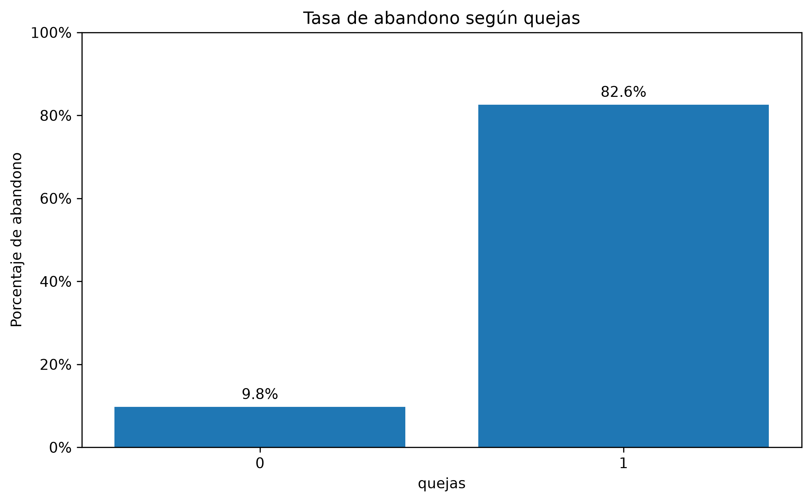

## Hallazgo 2. El estado del cliente presenta diferencias importantes en las tasas de abandono

La variable estado también presenta una diferencia considerable entre sus categorías. Los clientes con estado no activo (nivel 2) registraron una tasa de abandono del 47,5 %, mientras que los clientes con estado activo (nivel 1) presentaron una tasa del 5,6 %. Esto representa una diferencia aproximada de 41,9 puntos porcentuales.

El valor p obtenido fue de 6,86 × 10⁻¹⁵², lo que evidencia una asociación estadísticamente significativa entre el estado del cliente y el abandono. Esta diferencia permite observar que la condición de actividad del cliente está estrechamente relacionada con su situación frente al servicio.

No obstante, este resultado debe interpretarse con precaución. El estado del cliente podría estar relacionado directamente con la condición de abandono que se busca estudiar, por lo que es necesario revisar su disponibilidad temporal antes de utilizarlo como variable predictora. Si el estado fue registrado después o al mismo tiempo que el abandono, podría generar fuga de información en los modelos.

Por esta razón, aunque es una variable útil para describir las diferencias entre los grupos, su utilización para anticipar el abandono debe evaluarse cuidadosamente.

**Figura: Tasa de abandono según estado**

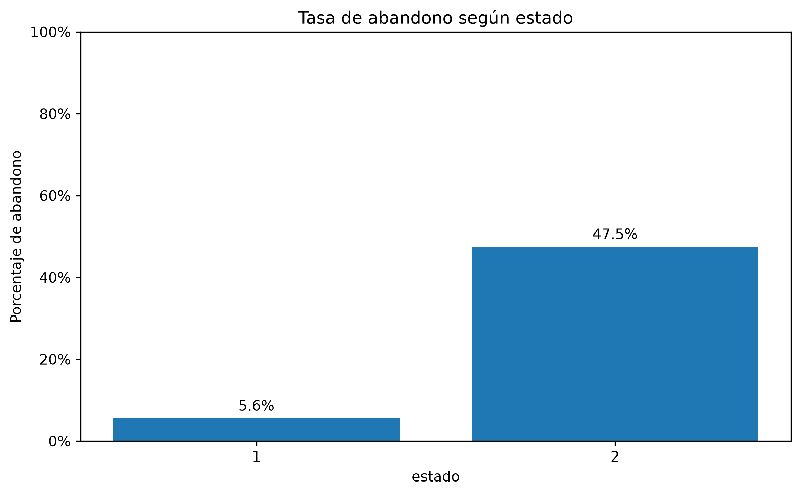

## Hallazgo 3. Los clientes que abandonan presentan menores niveles de utilización del servicio

La comparación de los segundos de uso muestra una diferencia importante entre los clientes que abandonaron y aquellos que permanecieron. La mediana de segundos de uso de los clientes que abandonaron fue de 1.256,5, mientras que para los clientes que permanecieron fue de 3.596,5. Esto significa que el nivel de uso registrado en el grupo que abandonó fue considerablemente menor.

Además, la prueba de Mann-Whitney arrojó un valor p de 1,84 × 10⁻⁸² y un delta de Cliff de -0,573, lo que refleja una diferencia estadísticamente significativa y un efecto de magnitud considerable entre ambos grupos. El signo negativo indica que los valores tienden a ser menores entre quienes abandonaron, de acuerdo con la orientación utilizada en el cálculo.

Este resultado permite identificar el nivel de utilización del servicio como una característica relevante para la caracterización del abandono. Una posible interpretación es que los clientes que reducen su utilización podrían estar mostrando un menor vínculo con los servicios de la empresa. Sin embargo, estos resultados corresponden a una comparación entre grupos y no permiten afirmar por sí solos que la reducción del uso sea la causa del abandono.

Para el proyecto, los segundos de uso representan una señal de comportamiento que podría contribuir a identificar clientes con menor actividad y complementar otras variables en la identificación anticipada del riesgo.

**Figura: Distribución de segundos de uso**

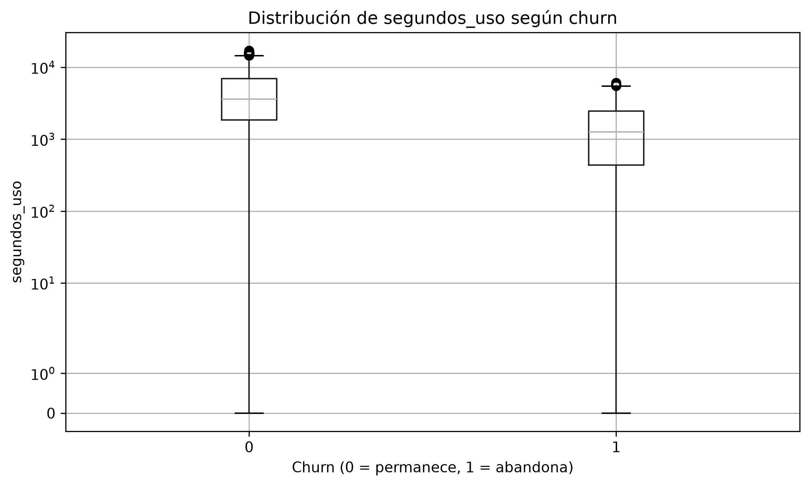

**Figuras complementarias de variables relacionadas con la utilización del servicio**

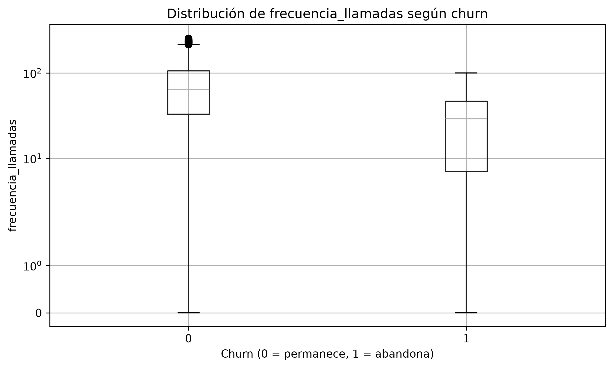

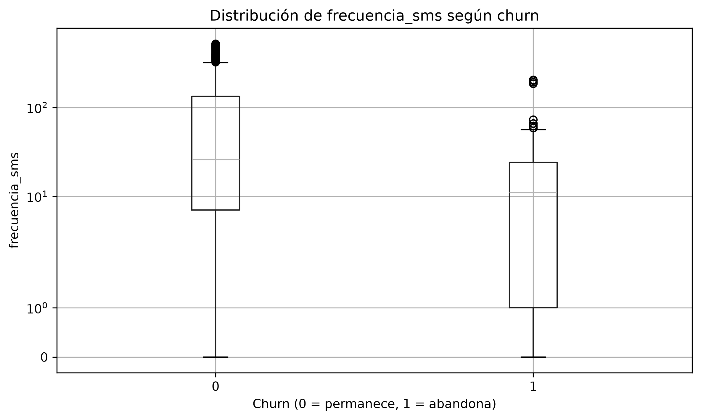

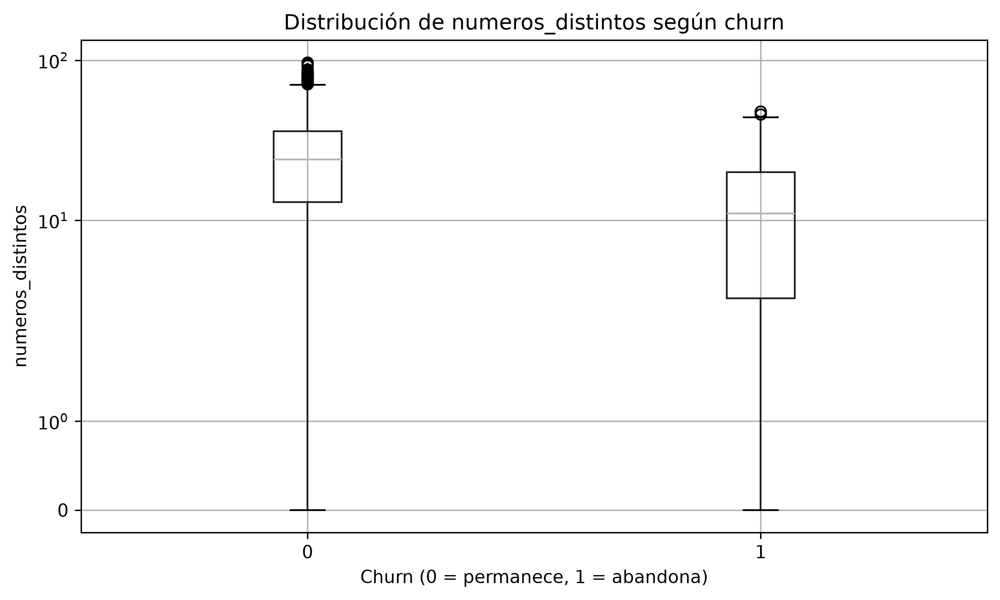

## Hallazgo 4. Los clientes que abandonan presentan un menor valor registrado como cliente

La variable valor_cliente también presenta una diferencia marcada entre los dos grupos. Los clientes que abandonaron registraron una mediana de 102,565, mientras que aquellos que permanecieron alcanzaron una mediana de 271,54. Esto indica que el valor registrado de los clientes que abandonaron fue considerablemente inferior al de quienes continuaron utilizando el servicio.

La prueba de Mann-Whitney obtuvo un valor p de 1,59 × 10⁻⁷⁹ y un delta de Cliff de -0,562, lo que evidencia una diferencia estadísticamente significativa y un efecto de magnitud considerable. Al igual que en los segundos de uso, el signo negativo indica que los valores tienden a ser menores en el grupo que abandonó.

Este resultado sugiere que el valor del cliente puede aportar información para diferenciar los perfiles de quienes abandonan y quienes permanecen. Además, al analizarlo junto con los segundos de uso, se observa que los clientes que abandonaron no solo registraron una menor utilización del servicio, sino también un menor valor en esta variable.

Para la empresa, esta característica puede ser útil al momento de analizar qué clientes presentan diferentes perfiles de comportamiento y cómo distribuir los esfuerzos de retención. Sin embargo, un menor valor del cliente no debe interpretarse automáticamente como una mayor probabilidad de abandono, sino como una característica que debe evaluarse junto con otras señales.

**Figura: Distribución del valor del cliente**

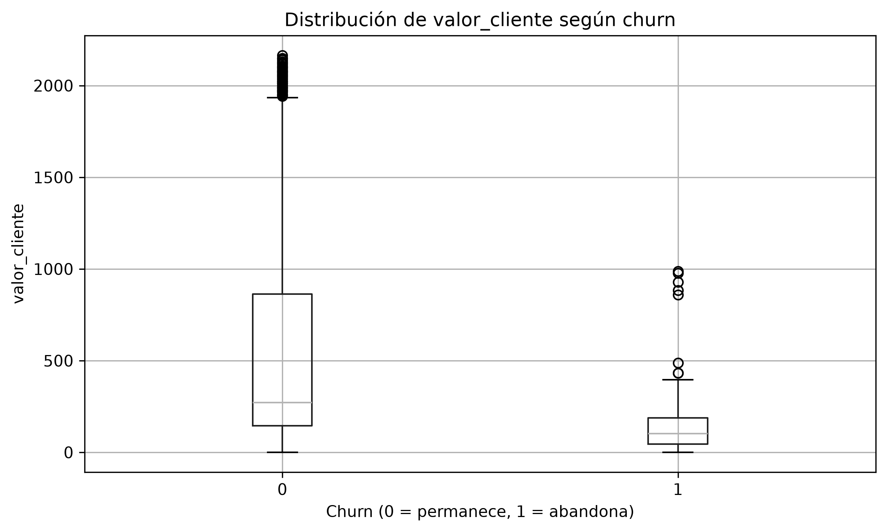

## Hallazgo 5. El plan de tarifa presenta diferencias en la proporción de clientes que abandonan

Los resultados muestran diferencias entre los clientes según el tipo de plan tarifario. Los clientes con plan de pago por uso (nivel 1) registraron una tasa de abandono del 16,8 %, mientras que aquellos con plan contractual (nivel 2) presentaron una tasa del 2,6 %. La diferencia entre ambos grupos es de aproximadamente 14,2 puntos porcentuales.

La prueba chi-cuadrado obtuvo un valor p de 2,64 × 10⁻⁸, lo que indica que existe una asociación estadísticamente significativa entre el plan tarifario y la condición de abandono. En los datos analizados, los clientes con plan de pago por uso presentan una mayor proporción de abandono que aquellos con plan contractual.

Este resultado permite reconocer que las condiciones de contratación también pueden estar relacionadas con el comportamiento de los clientes. Por lo tanto, el tipo de plan puede complementar la información obtenida de las variables de uso y de experiencia del servicio para caracterizar diferentes perfiles de abandono.

Para el proyecto, esta diferencia puede ser útil al momento de identificar grupos de clientes que requieren un análisis más detallado y evaluar si las estrategias de retención deberían considerar las condiciones de contratación.

**Figura: Tasa de abandono según plan de tarifa**

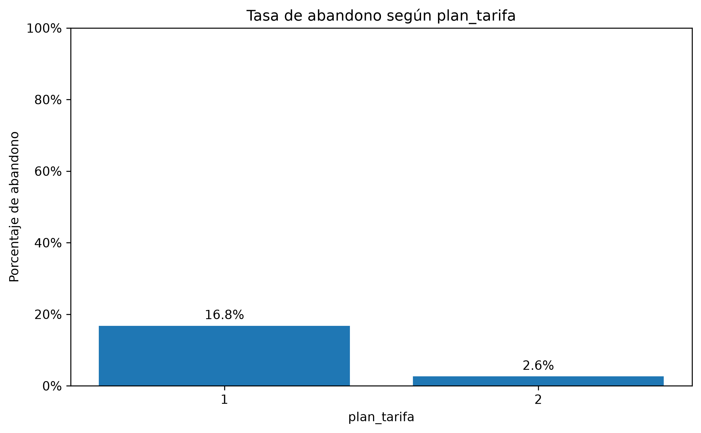

**Figuras complementarias de otras características de los clientes**

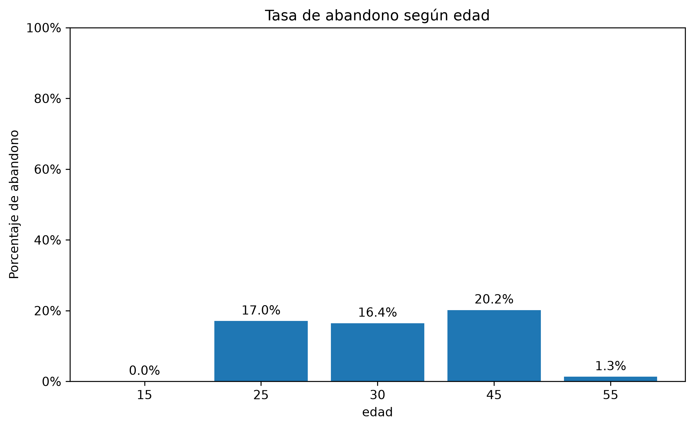

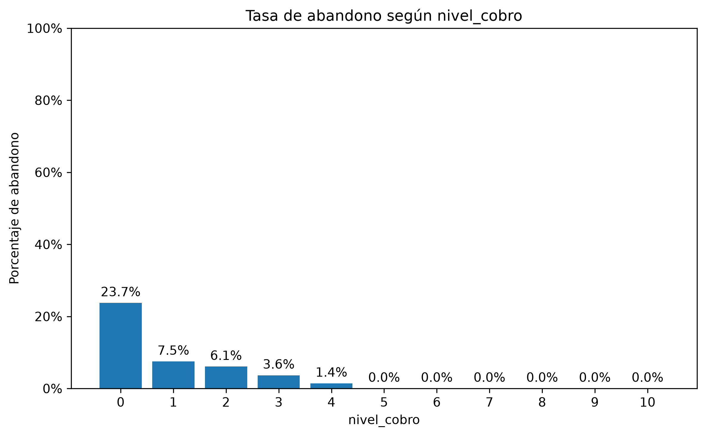

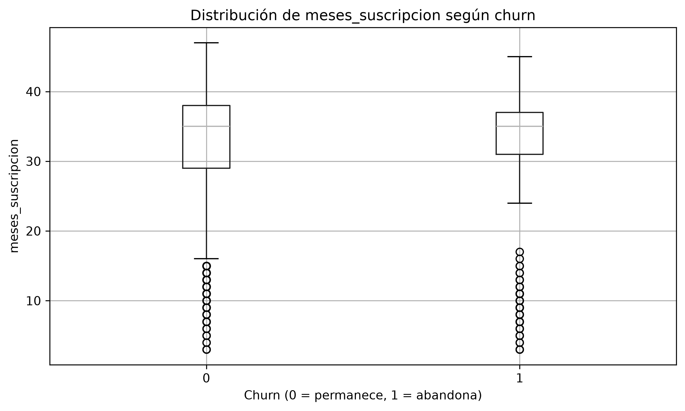

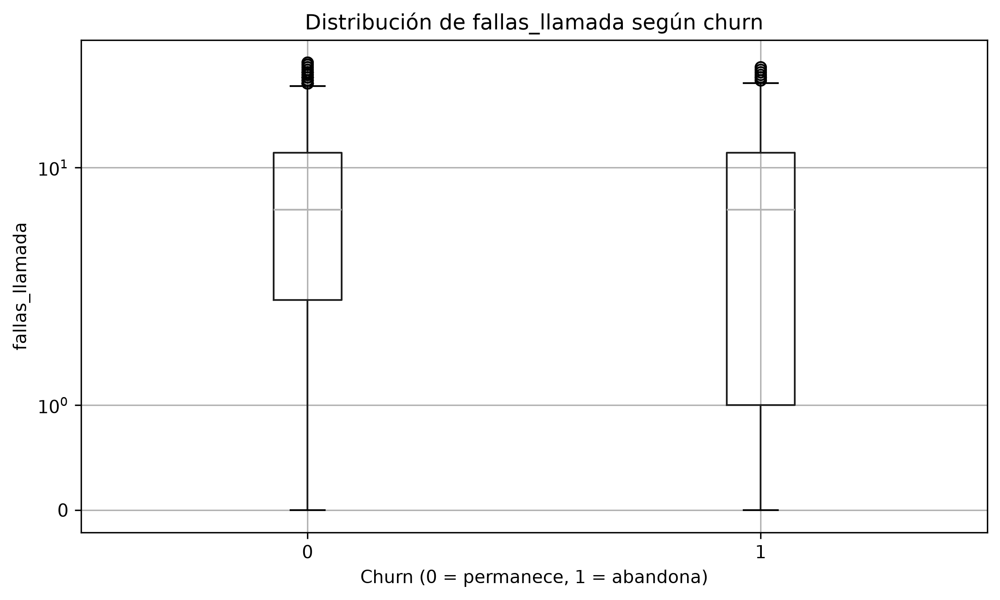

## Conclusión general

En conclusión, los resultados muestran que el abandono está asociado con diferencias en la experiencia del cliente, la utilización del servicio, el valor registrado y las condiciones de contratación. Las quejas y el estado del cliente presentan las diferencias más marcadas en las variables categóricas, mientras que los segundos de uso y el valor del cliente destacan entre las variables numéricas por sus diferencias entre grupos y la magnitud de sus efectos.

También se encontró que la frecuencia de llamadas, los números distintos contactados y la frecuencia de SMS presentan diferencias estadísticamente significativas entre quienes abandonan y quienes permanecen, a diferencia de los meses de suscripción y las fallas en llamadas que no mostraron diferencias estadísticamente significativas en esta comparación.

Estos resultados permiten reconocer características que podrían aportar información para identificar clientes con mayor riesgo de abandono. Sin embargo, la caracterización por sí sola no permite establecer qué clientes abandonarán en el futuro. Por ello, estos hallazgos servirán como base para la siguiente etapa del proyecto: evaluar la capacidad de los modelos predictivos para identificar y priorizar anticipadamente a los clientes que requieren acciones de retención.

# Relación entre variables

| # | Hallazgo | Cifra | Respaldo | Autor |
|---|---|---|---|---|
| 6 | Las quejas y el estado no activo son las señales más relacionadas con el abandono; las fallas de llamada, por sí solas, casi no presentan relación. | Con queja abandona el 82,6 % frente al 9,8 % sin queja (r = 0,55); clientes no activos, 47,5 % frente al 5,6 % de activos (r = 0,49); fallas de llamada r = 0,00. Base limpia: 2850 clientes. | `reports/tablas/relacion_churn.csv`, `reports/tablas/tasa_por_categoria.csv`, notebook 03. | Juanes |
| 7 | Algunos pares de variables contienen información muy similar; por eso salen del modelo `frecuencia_llamadas`, `valor_cliente` y `grupo_edad` (ver `docs/decisiones.md`). | `segundos_uso`–`frecuencia_llamadas`: r = 0,95; `frecuencia_sms`–`valor_cliente`: r = 0,92; `valor_cliente` presenta VIF = 53 y R² = 0,98 frente al resto. Sin ellas, ningún predictor pasa de VIF 2,3. | `reports/figures/correlaciones.png`, `reports/tablas/redundancias.csv`, `reports/tablas/vif.csv`. | Juanes |

## Hallazgos de los modelos predictivos

Evaluados una sola vez en los 713 clientes de prueba (112 abandonos), después de elegir el modelo con validación cruzada en entrenamiento.

| # | Hallazgo | Cifra | Respaldo | Autor |
|---|---|---|---|---|
| 8 | El bosque aleatorio es el modelo final: según el criterio fijado de antemano, supera a la logística por mucho más que el margen de 0,02 y es el único que cumple los cuatro criterios del Avance 2. | AUC-PR en validación cruzada 0,894 frente a 0,741 de la logística; en prueba 0,907 frente a 0,767 (azar: 0,16). Llamando al 20 % de los clientes alcanza el 91,1 % de los abandonos (logística: 74,1 %). Con los 190 contactos de la regla R2, 95,5 % frente al 86,6 % de la regla. | `reports/tablas/comparacion_modelos.csv`, `metricas_prueba_todos.csv`, `criterios_avance2.json`, `reports/figures/curvas_roc_pr.png`, notebook 04. | Juanes |
| 9 | La logística ordena bien, pero no le gana a la regla simple R2 (quejas o no activo) con la misma cantidad de contactos; el bosque sí, porque capta relaciones no lineales e interacciones. | Logística: −0,9 puntos frente a R2 (no cumple C2); bosque: +8,9 puntos. En el árbol, entre quienes se quejaron abandona el 90 % de los que usan poco el servicio y el 20 % de los que usan mucho (más de 5600 segundos). | `reports/tablas/criterios_avance2.json`, `reports/figures/arbol.png`. | Juanes |
| 10 | Sin queja ni estado el abandono se sigue anticipando: el uso y la suscripción tienen señal propia, pero no es lineal. | Sin esas dos variables, AUC-PR 0,804 con el bosque (captura 88,4 % llamando al 20 %) y 0,461 con la logística, frente al 0,16 del azar. | `reports/tablas/sensibilidad_variables.csv`, `reports/tablas/bayes_variantes.csv`. | Juanes |
| 11 | En el modelo final pesan sobre todo la queja y el estado, seguidos del uso y la antigüedad; el nivel de cobro y el plan casi no aportan. | Caída del AUC-PR al desordenar cada variable: queja 0,33; estado 0,21; segundos de uso 0,10; meses de suscripción 0,07; plan 0,00. | `reports/tablas/importancia_permutacion.csv`, `reports/figures/importancia.png`. | Juanes |
| 12 | Logística bayesiana: una queja multiplica las *odds* de abandonar por unas 35; el estado no activo, por 3,3. Para un cliente típico activo, una queja lleva la probabilidad de 6 % a 69 %. | OR queja 35,3 (IC 95 %: 20,4–62,0); estado 3,28 (2,12–5,11); cada falla +9 %; cada 6 meses de antigüedad −16 %. Edad y plan contienen el 1. R̂ ≤ 1,003 y 0 divergencias. | `reports/tablas/bayes_resumen.csv`, `bayes_probabilidades.json`, `bayes_diagnosticos.csv`, `docs/bayes_resultados.md`. | Juanes |
| 13 | La literatura esperaba un efecto de la queja mucho menor que el observado, lo que sugiere que la queja se registra cerca del abandono (posible fuga de información). | Previa (Corea): OR 1,7; solo los datos (logística clásica): 43,9; posterior: 35,3. Con otras previas, de 21 a 47. | `reports/tablas/bayes_sensibilidad_previa.csv`, `bayes_vs_clasica_coeficientes.csv`, `docs/fuentes_previas.md`. | Juanes |

# Priorización de clientes

La etapa de priorización permitió utilizar las predicciones del modelo final para identificar qué clientes presentan mayor riesgo de abandono y cómo podrían organizarse las acciones de retención. Para esto, se ordenaron los clientes según la probabilidad estimada de abandono, desde el riesgo más alto hasta el más bajo. También se evaluó qué proporción de los abandonos podría identificarse al contactar diferentes porcentajes de clientes y cómo cambian los resultados según la capacidad disponible para realizar acciones de retención.

## Hallazgo 14. El modelo concentra la mayoría de los abandonos en los primeros grupos de mayor riesgo

Al ordenar los clientes según la probabilidad estimada de abandono y dividirlos en diez grupos de tamaño similar, se observa que los primeros grupos concentran la mayor cantidad de clientes que efectivamente abandonaron. En particular, el primer decil reúne 67 de los 112 abandonos registrados en el conjunto de prueba, mientras que al acumular los dos primeros deciles se identifican 102 abandonos.

Esto significa que, al concentrar la atención en aproximadamente el 20 % de los clientes con mayor riesgo estimado, es posible identificar el 91,1 % de los abandonos. Este resultado muestra que el modelo permite ordenar a los clientes de manera útil para orientar los esfuerzos de retención hacia quienes presentan mayor probabilidad de abandonar.

| Decil | Clientes | Abandonos | Tasa de abandono | Lift | Captura acumulada |
|---|---:|---:|---:|---:|---:|
| 1 | 72 | 67 | 93,06 % | 5,92 | 59,82 % |
| 2 | 71 | 35 | 49,30 % | 3,14 | 91,07 % |
| 3 | 71 | 6 | 8,45 % | 0,54 | 96,43 % |
| 4 | 72 | 2 | 2,78 % | 0,18 | 98,21 % |
| 5 | 71 | 1 | 1,41 % | 0,09 | 99,11 % |
| 6 | 71 | 1 | 1,41 % | 0,09 | 100,00 % |
| 7 | 72 | 0 | 0,00 % | 0,00 | 100,00 % |
| 8 | 71 | 0 | 0,00 % | 0,00 | 100,00 % |
| 9 | 71 | 0 | 0,00 % | 0,00 | 100,00 % |
| 10 | 71 | 0 | 0,00 % | 0,00 | 100,00 % |

El lift permite comparar la tasa de abandono de cada decil con la tasa general de abandono del conjunto de prueba. Un valor superior a 1 indica que el grupo concentra una tasa de abandono mayor que la general. En este caso, los dos primeros deciles presentan los valores más altos, lo que respalda su utilidad para priorizar clientes.

## Hallazgo 15. La capacidad de contacto influye en la cantidad de abandonos que se pueden identificar

La priorización también permite analizar qué sucede cuando la empresa cuenta con diferentes capacidades para contactar a sus clientes. Se evaluaron tres escenarios: contactar aproximadamente al 10 %, al 20 % y al 30 % de los clientes con mayor riesgo estimado.

| Capacidad de contacto | Clientes contactados | Abandonos identificados | Porcentaje de abandonos identificados | Precisión de los contactos |
|---|---:|---:|---:|---:|
| 10 % | 71 | 66 | 58,93 % | 92,96 % |
| 20 % | 143 | 102 | 91,07 % | 71,33 % |
| 30 % | 214 | 108 | 96,43 % | 50,47 % |

Los resultados muestran que, al contactar al 10 % de los clientes con mayor riesgo, se identifica aproximadamente el 58,9 % de los abandonos. Cuando la capacidad aumenta al 20 %, la cobertura alcanza el 91,1 %. Al ampliar los contactos al 30 %, se llega al 96,4 % de los abandonos, aunque la precisión disminuye porque se incluyen más clientes que finalmente no abandonaron.

La cantidad de clientes seleccionados en estos escenarios se calcula directamente sobre el conjunto de prueba de 713 clientes. Por eso, el escenario del 10 % considera 71 clientes, mientras que el primer decil contiene 72. Debido a esta diferencia en el tamaño de los grupos, el primer decil registra 67 abandonos y el escenario de capacidad del 10 % identifica 66.

Esto evidencia que existe una relación entre la capacidad operativa y la cantidad de abandonos que pueden identificarse. Contactar a más clientes permite aumentar la cobertura, pero también implica destinar recursos a personas que podrían permanecer en el servicio.

Para la empresa, el escenario del 20 % representa una alternativa relevante, ya que permite identificar una proporción alta de los abandonos sin necesidad de contactar a toda la base de clientes.

## Hallazgo 16. Los clientes clasificados con mayor riesgo presentan menores niveles de utilización del servicio

Al comparar el 20 % de los clientes con mayor riesgo estimado frente al resto de los clientes, se observan diferencias en varias características relacionadas con el uso del servicio y el valor registrado.

| Variable | Mediana del 20 % de mayor riesgo | Mediana del resto de clientes |
|---|---:|---:|
| Segundos de uso | 1.260 | 3.794 |
| Valor del cliente | 113,805 | 280,6275 |
| Frecuencia de llamadas | 31 | 68,5 |
| Números distintos contactados | 10 | 24 |
| Frecuencia de SMS | 16 | 28 |
| Meses de suscripción | 35 | 34,5 |
| Fallas de llamada | 7 | 7 |

Las diferencias en segundos de uso, valor del cliente, frecuencia de llamadas, números distintos contactados y frecuencia de SMS fueron estadísticamente significativas (p < 0,001). En general, los clientes ubicados en el grupo de mayor riesgo presentan menores niveles de utilización del servicio y un menor valor registrado como clientes.

La mayor diferencia se observa en los segundos de uso, seguida del valor del cliente y la frecuencia de llamadas. Los efectos también muestran una tendencia negativa, lo que indica que estas variables tienden a presentar valores menores en el grupo de mayor riesgo.

Por otra parte, los meses de suscripción (p = 0,160) y las fallas de llamada (p = 0,516) no mostraron diferencias estadísticamente significativas entre los dos grupos. Esto indica que no todas las características permiten distinguir de la misma manera a los clientes priorizados por el modelo.

Este resultado complementa la caracterización inicial, ya que muestra que el grupo identificado con mayor riesgo también presenta patrones de menor utilización del servicio. Sin embargo, estas diferencias describen los perfiles de los grupos y no demuestran por sí solas que estas características causen el abandono.

## Hallazgo 17. Las quejas y el estado del cliente también diferencian al grupo de mayor riesgo

Al revisar las variables categóricas, se observa que los clientes con quejas y aquellos con estado no activo tienen una mayor presencia dentro del grupo de alto riesgo. También se identifican diferencias según el tipo de plan tarifario, el nivel de cobro y la edad.

| Característica | Categoría | Clientes en la categoría | Proporción de alto riesgo |
|---|---|---:|---:|
| Quejas | No presentó quejas (0) | 649 | 13,3 % |
| Quejas | Presentó quejas (1) | 64 | 89,1 % |
| Estado | Activo (1) | 545 | 5,1 % |
| Estado | No activo (2) | 168 | 68,5 % |
| Plan de tarifa | Pago por uso (1) | 648 | 21,6 % |
| Plan de tarifa | Contractual (2) | 65 | 4,6 % |

Estos resultados muestran que las quejas y el estado del cliente continúan siendo características importantes para distinguir a los clientes con mayor riesgo estimado. En particular, la proporción de clientes de alto riesgo es considerablemente mayor entre quienes presentaron quejas y entre quienes tienen estado no activo.

También se observan diferencias en el nivel de cobro. La categoría 0 registra una proporción de alto riesgo del 32,0 %, mientras que las categorías 1, 2 y 3 presentan proporciones de 9,9 %, 4,5 % y 2,1 %, respectivamente. En las categorías superiores las proporciones son generalmente bajas o iguales a cero. Sin embargo, algunas de estas categorías tienen muy pocos clientes, por lo que sus resultados deben interpretarse con precaución.

En cuanto a la edad, las categorías de 45, 25 y 30 años presentan proporciones de alto riesgo del 26,5 %, 23,2 % y 20,1 %, respectivamente. En las categorías de 15 y 55 años no se registraron clientes de alto riesgo. La diferencia general según edad fue estadísticamente significativa (p = 0,00067).

En conjunto, estos resultados permiten observar que las quejas y el estado del cliente son las características categóricas que muestran las diferencias más marcadas. El plan tarifario, el nivel de cobro y la edad también presentan diferencias, aunque su interpretación debe considerar el tamaño de los grupos.

Es importante aclarar que los porcentajes presentados representan la proporción de clientes clasificados con alto riesgo dentro de cada categoría, y no la distribución de las categorías dentro del grupo de alto riesgo.

## Hallazgo 18. El costo de los errores permite evaluar diferentes umbrales de decisión

Además de ordenar a los clientes según su riesgo, se evaluaron diferentes umbrales de probabilidad para determinar cuándo un cliente debería clasificarse como potencial abandono. Para esto, se consideraron dos tipos de errores: los falsos positivos, que corresponden a clientes clasificados como posibles abandonos que finalmente permanecen, y los falsos negativos, que corresponden a clientes que abandonan pero que no fueron identificados por el modelo.

Se utilizó una función de costo que asigna una penalización mayor a los falsos negativos. Esto permite evaluar cómo cambia el costo total de los errores cuando se da mayor importancia a no dejar pasar clientes que podrían abandonar.

| k | Umbral | Falsos positivos (FP) | Falsos negativos (FN) | Costo mínimo |
|---:|---:|---:|---:|---:|
| 2 | 0,35 | 26 | 14 | 54 |
| 5 | 0,20 | 54 | 6 | 84 |
| 10 | 0,20 | 54 | 6 | 114 |

La función de costo utilizada corresponde a:

`Costo = FP + k × FN`

En esta expresión, k representa el peso asignado a los falsos negativos. Cuando k aumenta, se penaliza más dejar sin identificar a un cliente que finalmente abandona.

Los resultados muestran que, al asignar una mayor importancia a los falsos negativos, el umbral de 0,20 permite reducirlos de 14 a 6, aunque aumenta la cantidad de falsos positivos. Esto evidencia que la selección del umbral depende de la capacidad operativa de la empresa y del costo relativo que se quiera asignar a cada tipo de error.

Es importante aclarar que los costos presentados corresponden a unidades relativas de penalización y no representan valores monetarios reales. Para convertirlos en costos económicos sería necesario contar con información adicional sobre el costo de contactar clientes, las acciones de retención y las pérdidas asociadas al abandono.

## Conclusión general

Los resultados de la priorización muestran que el modelo permite ordenar a los clientes según su riesgo estimado de abandono y concentrar una proporción importante de los casos en los primeros grupos. En particular, al contactar aproximadamente al 20 % de los clientes con mayor riesgo, se logra identificar el 91,1 % de los abandonos del conjunto de prueba.

Además, los clientes ubicados en el grupo de mayor riesgo presentan menores niveles de utilización del servicio, menor valor registrado como clientes y una mayor proporción de quejas y estados no activos. Estas características permiten describir el perfil de los clientes que el modelo considera prioritarios para las acciones de retención.

Por otra parte, el análisis de capacidad y de costos muestra que la decisión de contactar clientes no depende únicamente de la probabilidad estimada, sino también de los recursos disponibles y de la importancia que la empresa asigne a cada tipo de error. Por esta razón, el escenario del 20 % constituye una alternativa relevante para orientar las acciones de retención, aunque la decisión final debe considerar las condiciones operativas de la empresa.

Finalmente, los resultados de priorización deben interpretarse teniendo en cuenta las limitaciones identificadas durante el proyecto, especialmente la posible fuga de información asociada a variables como quejas y estado. Por ello, antes de implementar una estrategia real de retención, sería necesario verificar que las variables utilizadas estén disponibles en el momento en que se pretende anticipar el abandono y que no incorporen información posterior al evento.

Los resultados permiten concluir que el modelo ofrece una herramienta para organizar los esfuerzos de retención y dirigirlos hacia los clientes con mayor riesgo estimado, aprovechando la información disponible para apoyar la toma de decisiones de la empresa.